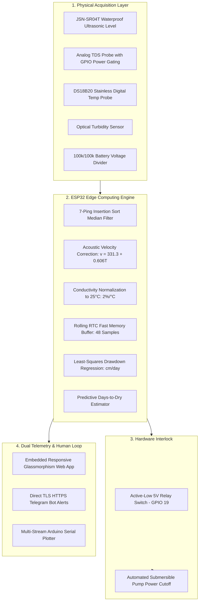

# 💧 Autonomous Underground Water Management System

[](firmware/UnderGroundWaterManagement_Main/)
[](https://techfest.org)
[](LICENSE)
[](docs/pinout.md)
[](analysis/drawdown_simulator.py)

> **Autonomous, sub-₹3,500 solar-powered IoT edge device engineered for Indian village aquifers and open wells. Tracks water depletion velocity and quality, predicts pump cavitation days in advance, and automatically trips pump power to prevent motor burnout.**

Designed and developed by **Team Neo-Venom** for **InnovateX: The Future Habitats Challenge** at **Techfest, IIT Bombay** (Theme: *IoT-Based Underground Water Management*).

---

## 📑 Official Round 1 Submission Deliverables

All required competition materials are cataloged inside the [`Resorce/`](Resorce/) folder:

| Deliverable | Description | Format |
|---|---|---|
| **01. Presentation Deck** | 10-Minute pitch deck with visual UI architecture | [`01_Presentation_Deck.pdf`](Resorce/01_Presentation_Deck.pdf) / [`.pptx`](Resorce/01_Presentation_Deck.pptx) |
| **02. Technical Abstract Report** | Comprehensive academic concept paper & gap analysis | [`02_Abstract_Report.md`](Resorce/02_Abstract_Report.md) |
| **03. Project Links** | Official submission index with source code pointers | [`03_Project_Links.txt`](Resorce/03_Project_Links.txt) |

---

## 📌 Table of Contents

1. [Executive Summary & Problem Reality](#-the-ground-reality-the-problem)
2. [Our Solution & What Makes It Different](#-our-solution--key-differentiators)
3. [End-to-End System Architecture](#-end-to-end-system-architecture)
4. [Core Engineering & Sensor Physics](#-core-engineering--sensor-physics)
5. [Hardware Pinout & Wiring](#-hardware-pinout--wiring)
6. [Bill of Materials (BOM) & Economics](#-bill-of-materials-bom--economics)
7. [Repository Structure](#-repository-structure)
8. [Firmware Setup & Flashing](#-firmware-setup--flashing)
9. [Sensor Unit Testing Suite](#-modular-sensor-testing-suite)
10. [Python Simulation Engine](#-python-simulation--data-validation)
11. [Scalability & National Alignment](#-scalability--national-alignment)

---

## 🚨 The Ground Reality (The Problem)

India is the **world's largest groundwater extractor**, drawing over **251 billion cubic meters annually**—exceeding China and the United States combined (Central Ground Water Board, 2022). 

Despite powering **85% of rural domestic drinking water** and **60% of agricultural irrigation**, extraction remains unmonitored at the village level:

* **Infrequent Government Data:** Official CGWB observation wells are monitored manually only **2 to 4 times a year**. A well can deplete mid-season in 72 hours with zero prior warning.
* **Prohibitive Cost of Commercial Telemetry:** Industrial Digital Water Level Recorders (DWLR) cost between **₹40,000 and ₹1,00,000+** per well, making dense village coverage impossible.
* **Separation of Quantity and Quality:** Over-extraction pulls in saline minerals ($>500\text{ ppm TDS}$ violating BIS IS 10500 standards) and silt, contaminating drinking sources without warning.
* **Devastating Pump Motor Burnout:** Farmers discover water exhaustion only when submersible pumps run dry and seize, costing **₹15,000 to ₹30,000** in repairs and driving farmers into debt.

---

## 💡 Our Solution & Key Differentiators

```
┌────────────────────────────────────────────────────────────────────────┐
│                              JALNETRA NODE                             │
│                                                                        │
│   [JSN-SR04T Level] ──┐                                                │
│   [TDS Probe (PPM)] ──┼──► [ESP32 Dual-Core Edge Compute]              │
│   [DS18B20 Temp °C] ──┤        │                                       │
│   [Turbidity %]     ──┘        ├─► [Least-Squares Regression: cm/day]  │
│   [Battery Voltage] ──┐        ├─► [Days-to-Dry Depletion Projection]  │
│   [Solar + 18650]   ──┘        │                                       │
│                                ├─► [Active-Low 5V Relay Cutoff] ──┐    │
│                                │                                  │    │
└────────────────────────────────┼──────────────────────────────────┼────┘
                                 │                                  │
                                 ▼                                  ▼
                 ┌──────────────────────────────┐        ┌─────────────────────┐
                 │ Local Glassmorphism Web App  │        │  PUMP MOTOR CUTOFF  │
                 │ Direct TLS Telegram Alerts   │        │ Prevents Dry-Run    │
                 │ Arduino Serial Plotter Graph │        │ Cavitation Burnout  │
                 └──────────────────────────────┘        └─────────────────────┘
```

| Typical Hackathon Project | Our Autonomous System |
|---|---|
| Displays raw water level on an external dashboard | **On-device edge regression** computes drawdown rate ($\text{cm/day}$) & **Days-to-Dry** |
| Passive monitoring only | **Active Hardware Interlock:** 5V relay automatically cuts off pump power on dry-run |
| Generic analog readings ruined by temperature | **Dual physical temperature compensation** on speed-of-sound and conductivity |
| TDS probes corrode in a week via DC electrolysis | **GPIO power gating:** probe energized for only $50\text{ ms}$ per sample cycle |
| Dependent on continuous grid power | **100% Off-grid solar autonomy:** ESP32 deep sleep ($<15\ \mu\text{A}$) with $\ge 7$ days reserve |

---

## 🏗️ End-to-End System Architecture



---

## 🔬 Core Engineering & Sensor Physics

### 1. Acoustic Speed-of-Sound Temperature Compensation
Sound travels faster in warmer air. A diurnal temperature swing from $20^\circ\text{C}$ to $35^\circ\text{C}$ causes an uncompensated ultrasonic sensor to drift by over $8\text{--}12\text{ cm}$. Our firmware recalculates acoustic velocity on every reading:
$$v = 331.3 + (0.606 \times T_{\text{water}})\quad [\text{m/s}]$$

### 2. Anti-Electrolysis GPIO Power Gating
Continuous DC current through submerged electrodes induces rapid galvanic plating and copper corrosion. In our firmware ([`config.h`](firmware/UnderGroundWaterManagement_Main/config.h)), probe VCC is tied to **GPIO 25**:
* GPIO 25 goes `HIGH` $\to 50\text{ ms}$ settling delay $\to$ 20 ADC samples captured.
* GPIO 25 immediately driven `LOW`.
* Reduces probe corrosion by $>98\%$, extending maintenance lifespan from 7 days to over 12 months.

### 3. Least-Squares Linear Drawdown Regression
The ESP32 fits depth readings over a rolling window in non-volatile RTC memory using:
$$\text{Slope } b = \frac{n\sum (t_i d_i) - \sum t_i \sum d_i}{n\sum t_i^2 - (\sum t_i)^2}$$
$$\text{Days to Dry} = \frac{D_{\text{pump intake}} - D_{\text{current}}}{b}$$
If depletion exceeds $15\text{ cm/day}$ or Days-to-Dry drops below 7 days, the pump is tripped and an emergency Telegram alert fires.

---

## 🔌 Hardware Pinout & Wiring

Strictly standardized in [`docs/pinout.md`](docs/pinout.md) and [`firmware/UnderGroundWaterManagement_Main/config.h`](firmware/UnderGroundWaterManagement_Main/config.h):

| Function | ESP32 GPIO | Direction | Connected Device | Wiring Specifications |
|---|---|---|---|---|
| **DS18B20 1-Wire Data** | **GPIO 4** | I/O | Temperature Probe Yellow Wire | $4.7\text{k}\Omega$ pull-up to 3.3V |
| **Ultrasonic Trigger** | **GPIO 26** | Output | JSN-SR04T TRIG | Direct 3.3V connection |
| **Ultrasonic Echo** | **GPIO 27** | Input | JSN-SR04T ECHO | $1\text{k}\Omega / 2\text{k}\Omega$ divider (5V $\to$ 3.3V safe) |
| **TDS Analog In** | **GPIO 34** (ADC1_6) | Input | Gravity TDS Module AOUT | Input-only ADC1 pin |
| **TDS Switched Power** | **GPIO 25** | Output | Gravity TDS Module VCC | Power gate for anti-electrolysis |
| **Turbidity Analog In** | **GPIO 35** (ADC1_7) | Input | Turbidity Module AOUT | $10\text{k}\Omega / 20\text{k}\Omega$ divider (4.5V $\to$ 3.0V) |
| **Solar Battery Sense** | **GPIO 32** (ADC1_4) | Input | Battery+ / TP4056 OUT+ | $100\text{k}\Omega / 100\text{k}\Omega$ voltage divider |
| **Pump Cutoff Relay** | **GPIO 19** | Output | 5V Relay Module IN | Active LOW (Trips on critical drop) |
| **Status Indicator** | **GPIO 2** | Output | Onboard Blue LED | Blinks on measurement cycle |

---

## 💰 Bill of Materials (BOM) & Economics

| Subsystem | Components | Prototype Cost (INR) | Mass Production Cost (1k units) |
|---|---|---|---|
| **Compute & Logic** | ESP32-WROOM-32 30-pin Board | ₹450 | ₹240 |
| **Level Telemetry** | JSN-SR04T Waterproof Ultrasonic Probe | ₹550 | ₹320 |
| **Quality Array** | Analog TDS Probe + DS18B20 + Turbidity | ₹950 | ₹480 |
| **Solar Power** | 6V 3W PV Panel + TP4056 + 18650 Li-ion | ₹550 | ₹340 |
| **Interlock Relay** | 5V Optocoupled Relay Module | ₹60 | ₹35 |
| **Enclosure & Cable** | IP65 Weatherproof Box + Cable Glands | ₹350 | ₹160 |
| **Passives & Board** | Resistors, Capacitors, Perfboard, Wiring | ₹120 | ₹45 |
| **TOTAL** | | **₹3,030** | **₹1,620** |

*Economic Viability:* At under **₹1,800 per node** in volume, covering an entire Gram Panchayat of **20 community wells costs under ₹36,000**—lower than the purchase price of a single commercial DWLR station.

---

## 📂 Repository Structure

```
UnderGroundWaterManagment/
├── LICENSE                                    ← Standard MIT Open-Source License
├── README.md                                  ← Primary Project Documentation (You are here)
│
├── Resorce/                                   ← Official Competition Submission Deliverables
│   ├── 01_Presentation_Deck.pdf               ← Pitch deck export
│   ├── 01_Presentation_Deck.pptx              ← Editable presentation source
│   ├── 02_Abstract_Report.md                  ← Round 1 formal concept paper & abstract
│   └── 03_Project_Links.txt                   ← Submission link index
│
├── docs/                                      ← Detailed Engineering Specifications
│   ├── problem-statement.md                   ← Hydrological crisis & gap analysis
│   ├── solution.md                            ← Edge system architecture
│   ├── components.md                          ← Component rationale, selection, & gotchas
│   ├── pinout.md                              ← Wiring diagrams, schematics, & power paths
│   └── implementation.md                      ← Build manual, math formulations, & power budget
│
├── firmware/                                  ← Production Firmware & Validation Suite
│   ├── platformio.ini                         ← PlatformIO build configuration
│   ├── UnderGroundWaterManagement_Main/       ← Master Production ESP32 Sketch
│   │   ├── UnderGroundWaterManagement_Main.ino
│   │   ├── config.h                           ← Central network, pinout, & well geometry
│   │   └── web_dashboard.h                    ← Embedded dark-mode glassmorphism dashboard
│   │
│   └── tests/                                 ← 9 Isolated Sensor Hardware Unit Tests
│       ├── 01_Blink_and_Serial/               ← Board sanity & USB 115200 baud check
│       ├── 02_DS18B20_Temperature/            ← 1-Wire ROM search & temperature test
│       ├── 03_JSN_SR04T_Ultrasonic/           ← Ultrasonic acoustic median filter test
│       ├── 04_TDS_Sensor/                     ← Anti-electrolysis GPIO power-gating test
│       ├── 05_Turbidity_Sensor/               ← Relative optical clarity % test
│       ├── 06_Battery_Voltage/                ← Solar Li-ion voltage divider test
│       ├── 07_Pump_Relay_Cutoff/              ← 5V Relay electromechanical cutoff test
│       ├── 08_Telegram_Alert_Test/            ← Direct TLS HTTPS Telegram alert test
│       └── 09_Full_Sensors_Serial_Plotter/    ← 6-Channel live Arduino Serial Plotter
│
├── analysis/                                  ← Data Science & Simulation Pipeline
│   ├── drawdown_simulator.py                  ← Aquifer extraction & regression simulator
│   ├── tds_calibration.py                     ← TDS temperature compensation verification
│   └── sample_telemetry_data.csv              ← 48-hour continuous time-series dataset
│
└── temp/                                      ← Internal Team Scratchpad & Rehearsal Notes
    ├── README.md                              ← Overview of internal working notes
    ├── goal.md                                ← Internal competition targets
    ├── tasks.md                               ← Internal team task board
    └── presentation.md                        ← 10-Minute pitch script & judge Q&A prep
```

---

## ⚡ Firmware Setup & Flashing

### Option A: Arduino IDE
1. Open Arduino IDE and add ESP32 board support via Boards Manager (`esp32` by Espressif Systems).
2. Install required libraries via Library Manager (`Ctrl+Shift+I`):
   * `OneWire` (by Paul Stoffregen)
   * `DallasTemperature` (by Miles Burton)
3. Open [`firmware/UnderGroundWaterManagement_Main/UnderGroundWaterManagement_Main.ino`](firmware/UnderGroundWaterManagement_Main/UnderGroundWaterManagement_Main.ino).
4. Update credentials in `config.h`:
   ```cpp
   #define WIFI_SSID     "Your_WiFi_Hotspot"
   #define WIFI_PASSWORD "Your_Password"
   #define TELEGRAM_BOT_TOKEN "Your_Bot_Token_From_BotFather"
   #define TELEGRAM_CHAT_ID   "Your_Numeric_Chat_ID"
   ```
5. Select Board: **ESP32 Dev Module**, set Upload Speed: **921600**, and click **Upload**.

### Option B: PlatformIO CLI
```bash
cd firmware
pio run --target upload
pio device monitor --baud 115200
```

---

## 🧪 Modular Sensor Testing Suite

Before flashing the master firmware, each hardware component can be verified individually using the isolated sketches in [`firmware/tests/`](firmware/tests/):

| Test Script | Hardware Tested | Expected Output |
|---|---|---|
| **`01_Blink_and_Serial.ino`** | ESP32 Core & USB | CPU 240MHz, Flash 4MB, blinking LED |
| **`02_DS18B20_Temperature.ino`** | 1-Wire Temp Probe | Unique 64-bit ROM address, °C and °F readings |
| **`03_JSN_SR04T_Ultrasonic.ino`** | Ultrasonic Level Probe | 10-ping median distance in cm and inches |
| **`04_TDS_Sensor.ino`** | Analog TDS Probe | Power ON $\to$ Read mV $\to$ Compute PPM $\to$ Power OFF |
| **`05_Turbidity_Sensor.ino`** | Turbidity Adapter | Module voltage & relative clarity % ($0\text{--}100\%$) |
| **`06_Battery_Voltage.ino`** | 100k/100k Divider | Battery voltage ($3.3\text{--}4.2\text{V}$) & charge % |
| **`07_Pump_Relay_Cutoff.ino`** | 5V Relay Module | Audible mechanical click every 3s (RUN vs CUTOFF) |
| **`08_Telegram_Alert_Test.ino`** | TLS WiFiClientSecure | Direct emergency Markdown alert delivered to phone |
| **`09_Full_Sensors_Serial_Plotter.ino`** | Complete Array | 6 Live graphical curves in `Tools -> Serial Plotter` |

---

## 🐍 Python Simulation & Data Validation

To verify the regression algorithm and model aquifer drawdown dynamics without physical hardware:

```bash
# Run aquifer drawdown cycle simulation (generates 48-hour continuous CSV dataset)
python analysis/drawdown_simulator.py

# Run TDS temperature compensation benchmark
python analysis/tds_calibration.py
```

Generated dataset: [`analysis/sample_telemetry_data.csv`](analysis/sample_telemetry_data.csv).

---

## 📈 Scalability & National Alignment

* **Phase 1 (Village Pilot):** 5 to 10 nodes deployed across open dug wells and recharge pits via local WiFi/Hotspot.
* **Phase 2 (Taluka Scale):** 100 nodes communicating over **LoRaWAN (SX1278 transceiver)** at 865–867 MHz to a single Gram Panchayat central gateway. Zero recurring SIM charges per well.
* **Phase 3 (National Mission Alignment):** Open API telemetry feeds directly into national hydrology programs:
  * **Atal Bhujal Yojana (ABHY):** Provides village water-security plans with real-time groundwater budgets.
  * **Jal Jeevan Mission (JJM):** Monitors source sustainability to prevent drinking water supply failure.

---

## 👥 Team & Maintainers

**Team Neo-Venom** — InnovateX: The Future Habitats Challenge, Techfest, IIT Bombay.  
* Primary Repository: [https://github.com/Neo-Venom/UndergroundWaterManagment](https://github.com/Neo-Venom/UndergroundWaterManagment)  
* License: [MIT License](LICENSE)
