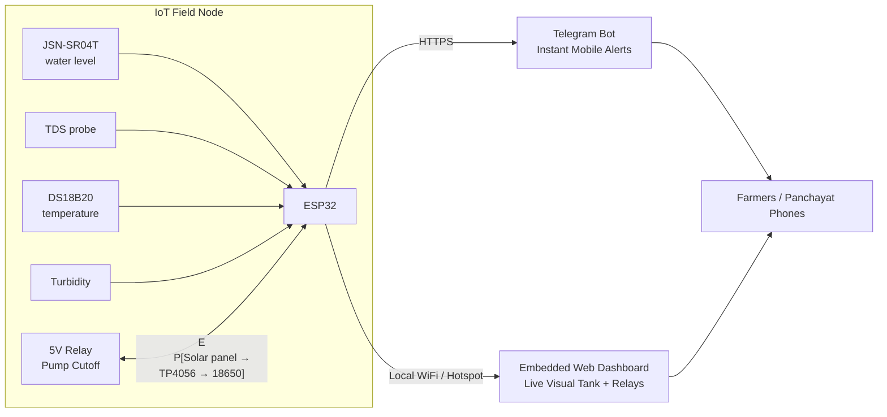

# 💧 Underground Water Management — Low-Cost Solar IoT Groundwater Monitor

Built for **InnovateX: The Future Habitats Challenge** (Techfest, IIT Bombay) — Theme: **IoT-Based Underground Water Management**.

An autonomous solar-powered ESP32 monitoring node that sits in a well, recharge pit, or reservoir and continuously monitors **how fast the water table is dropping**, **whether the water is safe**, and automatically **interlocks the pump** while dispatching **Telegram alerts** to farmers and gram panchayats before a crisis occurs.

---

## 1. The Problem (short version)

Groundwater is the backbone of Indian agriculture and rural drinking water, and it is being drawn down faster than it recharges in many regions. At the same time, much of it is contaminated (salinity, fluoride, nitrate, arsenic, etc.).

The core issue is **we don't know what is happening in time**:

- Monitoring wells are **sparse** and many are measured **manually, only a few times a year**.
- Professional telemetry loggers are **accurate but expensive**, so they are not deployed densely.
- Quality and quantity are usually **monitored separately**, if at all.
- Farmers and villagers **only find out after the well runs dry, pumps burn out, or someone falls sick**.

➡️ Full write-up: [`problem-statement.md`](problem-statement.md)

## 2. Our Solution (short version)

This is a ₹3–4k-per-node, solar-powered, WiFi-connected (LoRa-ready) sensor node that measures:

| Measurement | Sensor | Why |
|---|---|---|
| Depth to water | JSN-SR04T waterproof ultrasonic | Tracks depletion without water contact |
| Dissolved solids (TDS) | Analog TDS probe | Salinity/mineral contamination proxy (with anti-electrolysis power gating) |
| Water temperature | DS18B20 | Dual compensation: calibrates TDS & acoustic sound speed |
| Clarity | Turbidity sensor | Contamination / siltation proxy |
| Battery | Voltage divider on ADC | Node health & solar charge status |
| Pump Cutoff Interlock | 5V Relay module | Trips pump motor to prevent dry-run burnout |

Every cycle the node wakes, samples all sensors, computes an on-device **depletion trend**, updates the **live web dashboard**, fires **Telegram alerts** when thresholds are crossed, and deep-sleeps to save power.

The differentiator is **prediction + action, not just a dashboard**: *"At the current rate, this well reaches pump level in ~9 days"* and *"TDS above safe limit (BIS IS 10500) — don't drink, use alternate source."*

➡️ Full design: [`solution.md`](solution.md) and [`implementation.md`](implementation.md)

## 3. How It Works



## 4. Example Alerts

```
🚨 UNDERGROUND WATER MANAGEMENT: EMERGENCY DEPLETION ALERT
📍 Site: Community Well #1
📉 Drawdown Rate: 14.2 cm/day
⏳ Estimated Days-to-Dry: 9 days
🛑 Action Taken: Automated Pump Cutoff Interlock ENGAGED to prevent motor burn!
💡 Recommendation: Halt irrigation pumping immediately; initiate water rationing.
```

```
⚠️ UNDERGROUND WATER MANAGEMENT: WATER QUALITY ALERT
📍 Site: Community Well #1
🧪 TDS: 812 ppm (BIS Limit: 500 ppm)
💎 Relative Clarity: 61% (Threshold: 70%)
🛑 Health Notice: Water exceeds potable standards. UNFIT FOR DRINKING.
💡 Recommendation: Send samples for laboratory chemical testing.
```

## 5. Repository Structure

```
UnderGroundWaterManagment/
├── README.md                                  ← Project overview & quick start
├── goal.md                                    ← Vision, objectives, success metrics
├── tasks.md                                   ← Team task board / checklist
├── implementation.md                          ← Build plan, algorithms, testing
├── presentation.md                            ← Round 1 pitch + Round 2 demo script, Q&A
├── problem-statement.md                       ← Detailed problem, Indian water context & gaps
├── solution.md                                ← Detailed solution & system design
├── components.md                              ← Every component: why, what it does, gotchas
├── pinout.md                                  ← Pin map, wiring, power diagram
├── firmware/
│   ├── UnderGroundWaterManagement_Main/       ← Master ESP32 production firmware
│   │   ├── UnderGroundWaterManagement_Main.ino
│   │   ├── config.h                           ← Credentials, pins, geometry, thresholds
│   │   └── web_dashboard.h                    ← Embedded dark-mode glassmorphism dashboard
│   └── tests/                                 ← Step-by-step modular test sketches
│       ├── 01_Blink_and_Serial/               ← Board & serial sanity check
│       ├── 02_DS18B20_Temperature/            ← 1-Wire temperature test
│       ├── 03_JSN_SR04T_Ultrasonic/           ← Ultrasonic level test with median filter
│       ├── 04_TDS_Sensor/                     ← TDS test with GPIO power-gating
│       ├── 05_Turbidity_Sensor/               ← Turbidity & relative clarity test
│       ├── 06_Battery_Voltage/                ← Solar Li-ion voltage sense test
│       ├── 07_Pump_Relay_Cutoff/              ← 5V Relay dry-run cutoff test
│       ├── 08_Telegram_Alert_Test/            ← Direct HTTPS Telegram test
│       └── 09_Full_Sensors_Serial_Plotter/    ← Multi-sensor stream for Arduino Serial Plotter
```

## 6. Quick Start

### Hardware
Wire the node as per [`docs/pinout.md`](docs/pinout.md). Start on a breadboard with a bucket of water as your "well."

### Firmware
```bash
# 1. Install PlatformIO (VS Code extension or `pip install platformio`)
cd firmware

# 2. Create your private config (this file is git-ignored)
cp include/config.example.h include/config.h
#    edit WiFi, ThingSpeak key, Telegram token/chat id, well geometry

# 3. First run in BENCH_MODE (prints sensor values every 2 s, no WiFi/sleep)
pio run -t upload && pio device monitor

# 4. Calibrate (see docs/calibration.md), then set BENCH_MODE to 0 and flash again
```

> Using Arduino IDE instead? Create a new sketch, paste `src/main.cpp`, add `pins.h` and `config.h` as tabs, and install the **OneWire** and **DallasTemperature** libraries.

### Trend analysis
```bash
cd analysis
pip install -r requirements.txt
python trend.py --channel <THINGSPEAK_CHANNEL_ID> --pump-depth-cm 450
```

## 7. Documentation Index

| Doc | Read it when you want to… |
|---|---|
| [`goal.md`](goal.md) | know what "done" and "winning" look like |
| [`tasks.md`](tasks.md) | split work among 4 people |
| [`implementation.md`](implementation.md) | build and test it step by step |
| [`presentation.md`](presentation.md) | prepare the pitch and judge Q&A |
| [`docs/components.md`](docs/components.md) | understand why each part is used |
| [`docs/pinout.md`](docs/pinout.md) | wire it correctly |
| [`docs/calibration.md`](docs/calibration.md) | get trustworthy numbers |
| [`docs/cost-and-scalability.md`](docs/cost-and-scalability.md) | answer cost/scale questions |

## 8. Honest Limitations

We state these upfront because judges will ask:

- **TDS and turbidity are proxies**, not a substitute for lab tests. They flag *that something is wrong*, not *which* contaminant (fluoride, arsenic and nitrate are not detected directly).
- **Ultrasonic level sensing** works best in wide wells or with a stilling pipe; narrow borewells cause false echoes. A submersible pressure transducer is the accuracy upgrade path.
- Prototype uses a standard ESP32 dev board whose sleep current is dominated by on-board regulators; production would use a low-quiescent board.

Details and mitigations: [`implementation.md`](implementation.md#9-known-limitations--mitigations).

## 9. Roadmap

- [x] Single-node prototype (level + TDS + temp + turbidity)
- [ ] Depletion prediction + Telegram alerts
- [ ] Solar + deep-sleep field test
- [ ] LoRa mesh/gateway for no-WiFi villages
- [ ] Local-language (Hindi/Marathi) SMS alerts
- [ ] Pressure-transducer variant for borewells
- [ ] Multi-node dashboard with village map

## 10. Team

| Name | Role |
|---|---|
| _Member 1_ | Firmware lead |
| _Member 2_ | Hardware, power, enclosure |
| _Member 3_ | Cloud, dashboard, analysis |
| _Member 4_ | Research, report, presentation |

## 11. License

MIT — see [`LICENSE`](LICENSE).
